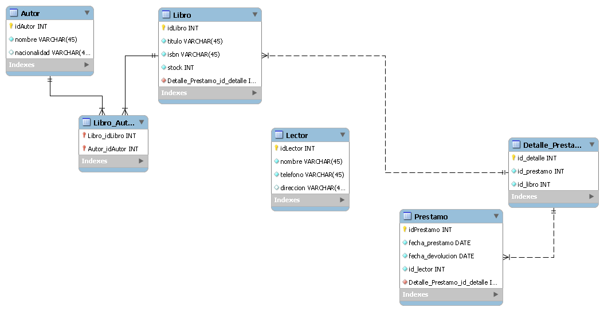

#  Proyecto de Base de Datos: Sistema de Gestión de una Librería

Este repositorio contiene el diseño del Modelo Entidad-Relación (EER) para un sistema de gestión de biblioteca/librería, desarrollado en **MySQL Workbench**.

---

## 1. Enunciado del Problema / Caso de Estudio
Se requiere diseñar una base de datos para administrar el inventario y los préstamos de una librería. El sistema debe registrar a los **Autores** y los **Libros** que estos escriben (un libro puede ser escrito por uno o varios autores, y un autor puede escribir varios libros). Asimismo, se debe llevar el control de los **Lectores** (usuarios registrados) y de los **Préstamos** que se realizan. Cada préstamo es realizado por un único lector en una fecha determinada y puede incluir uno o varios libros, registrando la fecha de devolución correspondiente.

---

## 2. Descripción de las Entidades y Atributos

* **`Autor`**
  * `idAutor` (INT, PK)[cite: 4]
  * `nombre` (VARCHAR)[cite: 4]
  * `nacionalidad` (VARCHAR)[cite: 4]

* **`Libro`**
  * `idLibro` (INT, PK)[cite: 4]
  * `titulo` (VARCHAR)[cite: 4]
  * `isbn` (VARCHAR)[cite: 4]
  * `stock` (INT)[cite: 4]

* **`Libro_Autor` (Tabla Intermedia)**
  * `Libro_idLibro` (INT, PK/FK)[cite: 4]
  * `Autor_idAutor` (INT, PK/FK)[cite: 4]

* **`Lector`**
  * `idLector` (INT, PK)[cite: 4]
  * `nombre` (VARCHAR)[cite: 4]
  * `telefono` (VARCHAR)[cite: 4]
  * `direccion` (VARCHAR)[cite: 4]

* **`Prestamo`**
  * `idPrestamo` (INT, PK)[cite: 4]
  * `fecha_prestamo` (DATE)[cite: 4]
  * `fecha_devolucion` (DATE)[cite: 4]
  * `id_lector` (INT, FK)[cite: 4]

* **`Detalle_Prestamo` (Tabla Intermedia)**
  * `id_detalle` (INT, PK)[cite: 4]
  * `id_prestamo` (INT, FK)[cite: 4]
  * `id_libro` (INT, FK)[cite: 4]

---

## 3. Explicación de las Relaciones

1. **Autor y Libro (Muchos a Muchos - N:M):** Se conecta mediante la tabla intermedia `Libro_Autor`, permitiendo que un libro tenga varios autores y un autor escriba varios libros[cite: 4].
2. **Lector y Préstamo (Uno a Muchos - 1:N):** Un lector puede realizar múltiples préstamos a lo largo del tiempo, pero un préstamo individual pertenece a un solo lector[cite: 4].
3. **Prestamo y Detalle_Prestamo / Libro (Muchos a Muchos - N:M):** Un préstamo puede registrar varios libros mediante la tabla `Detalle_Prestamo`[cite: 4].

---

## 4. Diagrama EER en MySQL Workbench

